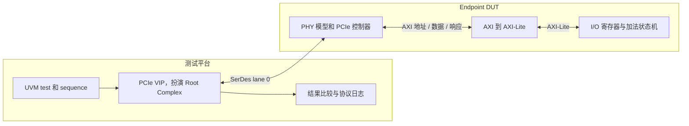

# 03 顺着一笔 PCIe 事务读源码

本章所有相对路径都从 `my_test_project/` 起算。初读时只跟踪三条线：谁发请求、请求在哪里变成 AXI 操作、谁判断结果正确。每找到一个边界，把它写在纸上，再进入下一层。

## 1. 这个系统为什么分成这么多块

PCIe 控制器接收协议事务、转发访问并生成响应。应用层只需要看到寄存器读写。这样更换一个应用时，保留控制器与链路；更换测试激励时，保留同一套接口与检查方式。把 VIP 当作一个会说 PCIe、会记录事务的虚拟主机，把 PHY 模型当作连接控制器与仿真串行信号的部件。DUT 是被测设计的总称，本例看 `pcie_ep` 和它下面的控制器、PHY 与应用。设计 IP 与 verification IP（VIP）分别承担硬件逻辑和仿真对手的角色。参见 [Synopsys PCIe VIP](https://www.synopsys.com/verification/verification-ip/pcie.html) 和 [Synopsys PCIe IP](https://www.synopsys.com/designware-ip/interface-ip/pci-express.html)。

| 术语 | 在这个用例里的含义 |
| --- | --- |
| Root Complex（RC） | 主机一侧，VIP 充当 RC，发配置请求和 Memory 请求 |
| Endpoint（EP） | 设备一侧，DUT 是可被枚举、可被访问寄存器的 PCIe 功能 |
| Lane / 链路 | lane 有一组发送差分线和一组接收差分线，多条 lane 可以组成一条链路。入门测试只连 lane 0 |
| LTSSM / L0 | LTSSM 管理链路训练和状态，L0 是进入正常链路工作的状态 |
| TLP | Transaction Layer Packet。Memory Read、Memory Write、配置访问与 Completion 都有对应的 TLP 类型 |
| BAR | Base Address Register。枚举时主机获得地址窗口要求并分派基址，后续可用基址加偏移访问设备功能 |
| DW | Doubleword，32 位或 4 字节。测试写 4 个 DW 来装 16 个 8 位元素 |
| Completion 和 tag | 读请求会得到完成响应。用 requester 和 tag 将响应关联到请求，读成功响应带数据 |

三层用三个问题区分。物理层解决链路训练、lane 与符号传输。数据链路层负责链路级可靠交付和相关控制机制。事务层表达这是什么访问、地址或目标、数据长度、字节使能，以及是否需要 Completion。普通 Memory Write 是 posted 事务，设备无需返回事务层 Completion。链路层确认和 AXI B 响应是另外的事件。Memory Read 是 non-posted，返回的数据要和对应请求关联。PCIe 厂商示例采用的用户总线可能不同，例如 AMD PG213 的用户侧示例使用 AXI4-Stream，这台 VM 的主工程桥接到 AXI/AXI-Lite 寄存器。协议概念参见 [PCI-SIG 规范入口](https://pcisig.com/specifications) 与 [AMD PCIe Memory Write 处理](https://docs.amd.com/r/en-US/pg213-pcie4-ultrascale-plus/Memory-and-I/O-Write-TLP-Processing)。

## 2. 按入口追到测试类

| 顺序 | 读哪个文件 | 带什么问题看 |
| --- | --- | --- |
| 1 | `sim/Makefile`、`rtl/pcie_rtl.f` | 当前编译顶层是什么，实际参与编译的 RTL 位于哪里，测试名从哪传入 |
| 2 | `tb/tb_top.sv`、`tb/tb_include.sv` | 顶层怎样 include 测试类、实例化接口、启动 `run_test()`、输出 `pcie.fsdb` |
| 3 | `tb/dut_instance/pcie_dut.sv`、`tb/vip_instance/u_pcie_vip.sv` | 找 `u_pcie_ep` 和 VIP 的 lane 接线，VIP 的 RX 接 DUT 的 TX |
| 4 | `tc/pcie_base_test.sv`、`tb/pcie_vip/pcie_env.sv` | 谁创建 env、RC agent、虚拟 sequencer、时钟复位和上电组件，谁配置 lane、速率以及日志 |
| 5 | `tb/clk_reset_module.sv`、`tb/power_up_module.sv` | 如何通过 virtual interface 把 UVM 组件的配置与行为传到实际 HDL 接口 |
| 6 | `tc/pcie_mem_pkg_test.sv`、`tb/seq_lib/*sequence.sv` | 测试要跑哪几段 sequence，哪个条件超时会卡住，哪一行比较读回值 |
| 7 | `rtl/pcie_ep.sv` | `u_pcie_iip_device` 的 AXI master 连到哪里，向量应用何时更新寄存器和状态 |

UVM 类层和 HDL 模块层是两套层级。`tb_top` 是 HDL 入口，包含接线和 interface 实例。`uvm_test_top` 是 UVM 入口，包含 test、env 和 agent 等组件。通过 `uvm_config_db` 传递 virtual interface，类可以观察和驱动物理的 HDL 接口。构建阶段负责创建和配置组件，连接阶段关联组件之间的端口，运行阶段驱动带时间的 sequence。Raise objection 表示测试的时序活动未结束，drop 后相应 phase 可以收尾。若等待链路的代码没走到 drop，通常应先查之前的 wait 条件。

Sequence 描述刺激及步骤，sequence item 表示一次操作的数据，sequencer 在多个来源之间安排 item，driver 将操作交给接口，monitor 从实际接口采样。Scoreboard 或测试内检查对比期望与实测。这里虚拟 sequencer 协调不同子 sequencer，现有向量检查直接写在 memory sequence 里。后续可把持续检查抽到独立 scoreboard，避免激励和预期逻辑绑在同一段。UVM 1.2 的学习入口见 [Accellera UVM 手册和参考实现](https://accellera.org/downloads/standards/uvm)。

## 3. 按测试进度看四个阶段

### A. 链路建立

`pcie_env.sv` 将根端口配置为一条 lane、2.5 GT/s，代码中 VIP 规范配置为 PCIe 1.1。先有参考时钟和复位，然后 VIP 启动链路序列。去 `pcie_link_up_test.sv` 找四个条件，逐项记下是在 `pl_status` 还是 `dl_status` 上观察的。第一次读只需知道 Detect、Polling、Configuration 与 L0 说明链路经历了从检测对端到训练可用的过程。具体状态是否出现和先后时刻以本次日志和波形为准。

目录里有 Gen6 与 CXL 的内容，厂商示例也单列了 Gen6 拓扑。当前这份应用向量用例给出的证据覆盖配置好的单 lane 2.5 GT/s 路径。学习 Gen6 时另从 VIP 示例选择相应拓扑与用例，记录协商速率、宽度和工作模式，再追 FLIT 等该模式的行为。

### B. 枚举与 BAR

先把一次 Config Read 看成“主机问设备你是谁”。再读 `enumeration_device_sequence.sv`，找 Vendor/Device ID 读取、BAR 探测、基地址写回和读回确认。BAR 探测会通过读回掩码识别窗口大小。区分配置空间的 BAR 寄存器偏移和它映射出的 Memory 地址窗口，二者通过不同类型的事务访问。历史日志中的 BAR0 是 64 KiB、基址 `0x0040_0000`，配置功能被允许进行 Memory 访问后，即可向这个地址窗口发送 TLP。

### C. 写向量与启动

`pcie_mem_pkg_sequence.sv` 把 A、B 各 16 字节按 4 个 DW 发送。每条写请求带地址、DW 长度和字节使能。以 `BAR0+0x20` 为例，事务从 RC VIP 发出，到 Endpoint 译码后成为 AXI 访问。主工程由 `axi_to_axi_lite_intf` 将控制器侧的 AXI 转接到较简单的寄存器端口。这让寄存器模块专注处理一次地址译码、字节写掩码与读回，完整 AXI 的 burst 等语义由上游桥处理。

| BAR0 字节偏移 | 设计用途 | 实际观察 |
| --- | --- | --- |
| `0x00` | CTRL 命令和状态 | RTL 按寄存器字节解释 bit 7 为 start，bit 6 为 busy |
| `0x10–0x1f` | 16 个 A 元素 | 基址若是 `0x0040_0000`，首个 DW 写到 `0x0040_0010` |
| `0x20–0x2f` | 16 个 B 元素 | 当前 sequence 写 B 后逐 DW 读回校验，日志 ID 可搜 `WRCHK` |
| `0x30–0x3f` | 16 个结果元素 | AXI 侧只读，计算完成后由硬件更新 |

打开 `vec8x16_add_regs_intf`，先辨认来自寄存器阵列的读值、硬件写回值和更新使能，再看状态机。IDLE 看到 start 时清掉启动位，置 busy 并进入 BUSY。BUSY 逐元素并行做加法，把每个结果截断到 8 位并写回，最后清 CTRL 回到 IDLE。从寄存器边界调试时，优先看哪个字节收到 `WSTRB`，再看 CTRL 与状态寄存器是否在相应的上升沿更新。

测试里写入 CTRL 的 VIP payload 打包形式是 `32'h8000_0000`，RTL 检查的是 CTRL 字节的 bit 7。跟踪这笔写时分别记 VIP payload、线上的 byte enable、AXI WDATA/WSTRB 和寄存器字节。每层的打包和显示方式要在波形里对齐，才能判断重排发生在哪。

### D. 读回和比较

对 `BAR0+0x30` 发一个长度为 1 DW 的 Memory Read。首先观察控制器侧 `ARVALID && ARREADY`，然后观察返回侧 `RVALID && RREADY`。控制器把返回数据封装为 Completion，VIP 根据请求关联拿到 payload，最后 sequence 发出 `VEC_ADD` 检查。写操作的 AW、W 和 B 是独立通道，读操作的 AR 与 R 也是独立通道。各通道在采样上升沿同时满足 VALID/READY 时传输，因此等待期间要看地址或数据是否稳定。协议细节参见 [Arm AMBA AXI 协议规范](https://developer.arm.com/documentation/ihi0022/latest/)。

手算第一组结果。A 的四个字节是 1、2、3、4，B 对应字节是 17、18、19、20，得到 18、20、22、24，也就是十六进制 12、14、16、18。按 sequence 的组包显示，首个结果 DW 为 `0x18161412`。日志出现四次结果检查时，你应该能说出它比较的是哪 16 个元素。

## 4. 从能读代码到能评估验证质量

主线用例检查了连通性和一组算术数据。做代码检查时，可以把下列三项直接写成你的第一版改进任务。

| 在源码里看到的行为 | 为什么值得做实验 | 如何测 |
| --- | --- | --- |
| 参考结果目前按 32 位打包数相加。RTL 按四个独立字节相加 | 当前数据无跨字节进位，两种算法结果相同。有字节溢出后，32 位加法会污染相邻元素 | 例如 A 组包为 `0x000000ff`，B 为 `0x00000001`，逐字节结果为 0，整 DW 加法得到 `0x00000100`。先写独立逐字节参考函数，再加这一项 |
| 完成轮询检查返回值的 bit 7，而 RTL 将 busy 定义为 CTRL 字节 bit 6 | 当前计算很短，经过 PCIe 的读可能在 busy 结束后才返回，单靠历史通过无法证明完成协议 | 先核实 VIP/AXI/寄存器字节映射，再在应用侧观察 busy 的置位和清零。延长计算延迟或增加明确的完成状态后，写有上限的轮询和明确的超时报错 |
| A 写入、B 读回和最终结果在同一条 sequence 中 | 若错误出现在 A 的地址译码、字节使能或打包，最终错值只说明端到端失败 | 补 A 逐 DW 读回、部分字节写、写只读结果、复位中断与 AXI 背压。对请求和响应各保存第一个出错的地址、tag、strobe、期望值和实测值 |

做一个很小的追踪练习。用表格记录 `用例/seed → 链路 L0 → BAR0 分配 → 写 A/B 的一笔 TLP → AXI 请求握手 → CTRL 变化 → 结果寄存器 → 读 Completion → VEC_ADD`。每一格写文件、时间戳或信号名。出现不一致，找到两边各一个相邻边界，找出第一处偏差再修改。

[下一章：自己写一遍寄存器、算术和自检逻辑](04-hands-on.md)
